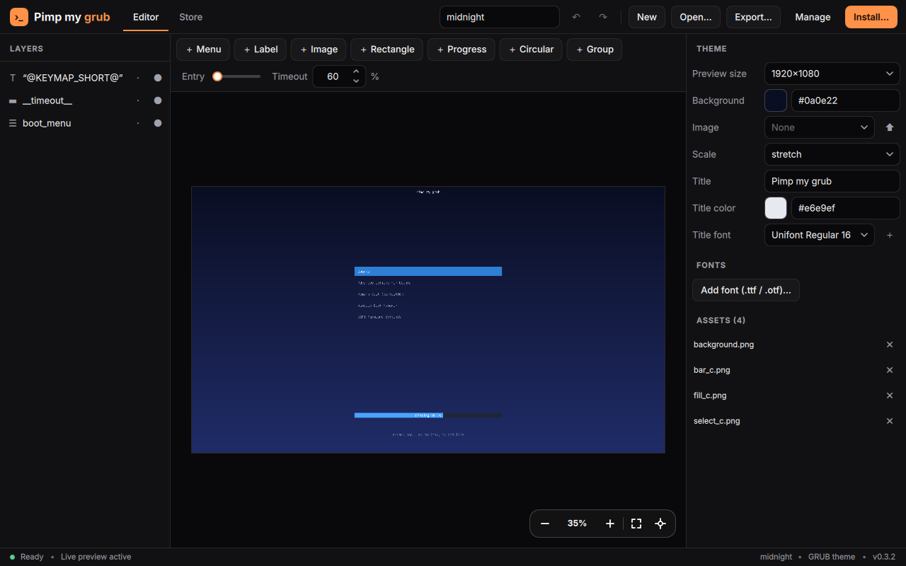
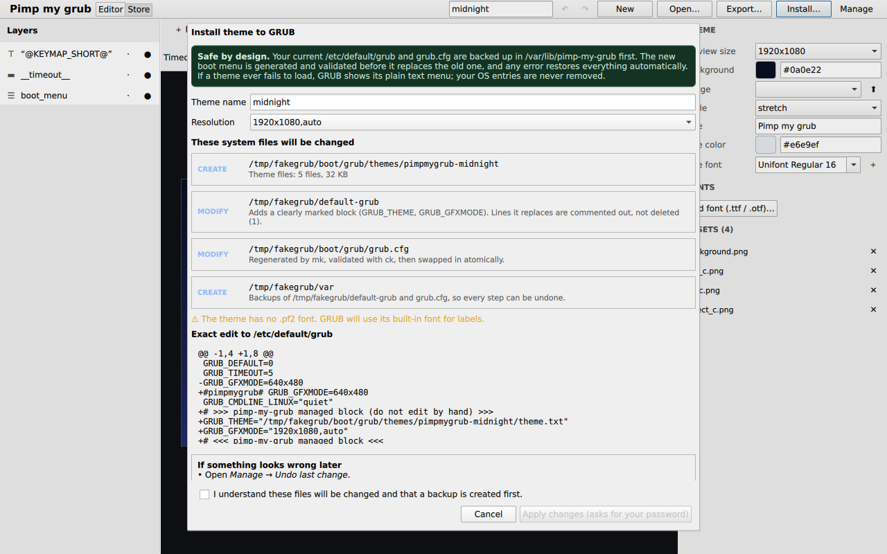

<p align="center"></p>

# Pimp my grub

**A native Linux app to design GRUB themes visually, browse a theme store, and install a theme safely.**
Qt 6 + Rust. No webview, no Electron. Every change to your system is shown to you first and can be undone.





> **Status: early (v0.2.1).** The editor, store UI and installer are working and tested in a sandbox, but the real
> apply-to-`/boot` path has **not** been exercised on real hardware yet. Try it in a VM first. See [Status](#status-what-is-and-isnt-verified).

## Why this exists
GRUB themes are a pile of `theme.txt`, PNG slices and `.pf2` fonts that you edit blind and only see after a reboot.
The goal of this project, as set out at the start:

-  **Build a theme**: drag, resize, snap, layers, inspector, live preview
-  **Theme-Store**: a search bar and preview cards, fed by popular theme repositories (buggy ui)
-  **Made in Rust** that stays fast on **low-end devices**
- install themes through a **guided, GRUB-respecting, reversible** flow that can never destroy booting, and tells you
  exactly what it changed in system files, with a **confirmation** step

## Inspiration and references

| Project | What it inspired |
|---|---|
| [sooocil/grubstudio](https://github.com/sooocil/grubstudio) | a visual theme builder and a `theme.txt` parser/exporter |
| [GRUB-Theme-Builder](https://erikenga2.github.io/GRUB-Theme-Builder/) | a browser-based GRUB theme builder, the starting "web version" idea |
| [Aleph1-9012/Sidonia](https://github.com/Aleph1-9012/Sidonia) | the install procedure: back up first, regenerate `grub.cfg` safely, roll back. Its themes are also the test corpus for the parser and renderer |

The store's curated list is seeded from popular repositories found through GitHub's `grub-theme` topic
(for example Gorgeous-GRUB, minegrub-theme, distro-grub-themes, fallout-grub-theme, catppuccin/grub, dedsec and darkmatter,
HyperFluent, CyberGRUB-2077, Sidonia). Themes stay in their own repositories under their own licences; the app only downloads them on demand.

## How the design got here (decisions)
1. **Prototype:** Tauri 2 + Svelte + Canvas2D (web UI) was built first. Svelte and Canvas2D were chosen for low overhead; the store
   combined a curated repo list with GitHub topic search; install went through `pkexec`.
2. **Rewrite to native:** the requirement changed to *not a web app*, *native for each popular distro*. The result is
   **Qt 6 for the window and Rust for everything else**, with one thin `QQuickPaintedItem` that blits a Rust software renderer.
   The web prototype was chucked in my bin of of man-made horrors beyond saving.
3. **Safety first, taken from Sidonia's approach:** keep GRUB's architecture intact (`/etc/default/grub` + `grub-mkconfig`),
   never hand-edit `grub.cfg`, make every change reversible, and always show what will change before asking for a password.

## Features
- **Editor:** layers, drag/resize with snap guides, undo/redo, zoom/pan, inspector, preview sizes (1920×1080 … 800×600).
  Percent-based positions such as `50%-120` survive dragging. Components: boot menu, label, image, rectangle, progress bar,
  circular progress, groups.
- **Accurate preview:** real GRUB `.pf2` fonts are drawn glyph by glyph (so text looks like it will at boot), 9-slice
  `select_*.png` styles, icons and progress bars. TTF/OTF → PF2 conversion uses GRUB's own `grub-mkfont`.
- **Store:** search, sort by popularity, cards with lazily loaded thumbnails, resolution variants, *Edit* or *Install* in one click,
  plus live search of GitHub's `grub-theme` topic. `cargo run -p pimp-my-grub-core --example build_catalog` (with `GITHUB_TOKEN`) pre-indexes the curated repos so the app needs no API calls on startup (script written, not yet run against live GitHub).
- **Installer:** review screen listing every file that will change, the exact diff of `/etc/default/grub`, recovery instructions
  and a consent checkbox. Then polkit asks for your password.
- **Manage:** *Undo last change* or *Remove all* at any time.
- **Light:** CPU rendering only when something changes (no frame loop, no GPU needed), a virtualised store grid with downscaled
  async thumbnails, one small native executable.
- **Look:** a built-in dark theme with an orange accent, drawn with Qt Quick Controls' `Basic` style so it looks the same on every desktop (set `QT_QUICK_CONTROLS_STYLE` to override).

## Safety model
| Step | Guarantee |
|---|---|
| Backup | `/etc/default/grub`, `grub.cfg` and the previous theme go to `/var/lib/pimp-my-grub/backups`; the very first copy is kept forever in `/var/lib/pimp-my-grub/original` |
| `/etc/default/grub` | one marked block is added; conflicting `GRUB_THEME` / `GRUB_GFXMODE` / `GRUB_TERMINAL=console` lines are **commented out, never deleted** |
| `grub.cfg` | never edited by hand: regenerated with `grub-mkconfig` into a temp file, checked with `grub-script-check`, must reference the new theme and still contain menu entries, then renamed atomically |
| Failure | any error triggers an automatic restore (undo stack); covered by `tests/helper.test.sh` including failure injection |
| Undo | surgical, so your later edits to `/etc/default/grub` are kept |
| Input | only `txt png jpg jpeg tga pf2`, no symlinks, safe file names, ≤ 40 MB; the staged copy is re-validated as root |
| Boot | if a theme ever fails to load, GRUB shows its plain text menu; OS entries are never touched |

Manual recovery: copy `/var/lib/pimp-my-grub/original/default-grub` back to `/etc/default/grub`, then `sudo update-grub`
(Debian/Ubuntu) or `sudo grub2-mkconfig -o /boot/grub2/grub.cfg` (Fedora/openSUSE).

Privileges: packages install `/usr/libexec/pimp-my-grub/pimp-my-grub-helper` and a polkit action (`dev.pimpmygrub.helper`), so the
prompt names the app. Without it (AppImage, dev builds) the app falls back to `pkexec /bin/sh -c <embedded script>`.
**Supported:** GRUB 2 on Debian/Ubuntu/Arch/Fedora/openSUSE families. 
**Not supported:** ostree/immutable systems, systemd-boot, rEFInd.

## Install
Check Releases(**.deb and .Appimage available**).

## Build from source
Rust 1.85+, Qt 6 (Quick, Quick Controls 2, Dialogs), clang. `grub-common` is optional at build time: previews use a built-in
font, or GRUB's full `unicode.pf2` when it is installed; `grub-mkfont` (from `grub-common`) is only needed to convert your own fonts.
```bash
# Debian/Ubuntu 24.04+
sudo apt install qt6-base-dev qt6-declarative-dev clang libclang-dev \
  qml6-module-qtquick qml6-module-qtquick-controls qml6-module-qtquick-layouts \
  qml6-module-qtquick-dialogs qml6-module-qtquick-templates qml6-module-qtquick-window \
  qml6-module-qtqml-workerscript
# Fedora: qt6-qtbase-devel qt6-qtdeclarative-devel clang-devel     Arch: qt6-base qt6-declarative clang

QMAKE=$(command -v qmake6) cargo build --release -p pimp-my-grub
./target/release/pimp-my-grub examples/midnight     # opens the demo theme
```
Tests: `cargo test -p pimp-my-grub-core && sh tests/helper.test.sh`.
`PIMPMYGRUB_CATALOG=catalog.json` replaces the bundled store catalog (offline mirrors, testing).
Note: the first build compiles the Qt bindings (`cxx-qt-lib`) and takes about ten minutes (longer on one core).

Packages (see `packaging/`):
open the packaging directory in terminal and run `build-binary.sh`

| Distro family | Package | Build |
|---|---|---|
| Debian, Ubuntu, Mint | `.deb` | `sh packaging/build-deb.sh` |
| Fedora, openSUSE | `.rpm` | `packaging/pimp-my-grub.spec` |
| Arch, Manjaro | `PKGBUILD` | `makepkg -si` in `packaging/` |
| Anything else | AppImage | `packaging/build-appimage.sh` |

Flatpak is intentionally not offered: a sandbox cannot run polkit against `/boot`.

### If the app does nothing when started
Run `pimp-my-grub` from a terminal. If it prints `module "QtQuick.Dialogs" is not installed` (or another module), install the
`qml6-module-*` packages listed above (Debian/Ubuntu) or the full `qt6-declarative` package (Fedora/Arch/openSUSE).
Started from the app menu, a failure now shows an error dialog and writes `~/.cache/pimp-my-grub/last-run.log`.
Release binaries built against Qt private API only run on the same Qt 6 minor version; use the AppImage elsewhere.

## Repository layout
```
crates/core/   engine, no GUI deps: theme.txt model, PF2 reader, tiny-skia renderer, editor + undo, store, installer client
crates/app/    Qt Quick shell (cxx-qt): QML UI and the painted viewport item
helper/        pimp-my-grub-helper.sh, the only code that touches system files
packaging/     deb / rpm / PKGBUILD / AppImage, desktop file, polkit policy, metainfo
examples/      "midnight", a small demo theme
tests/         helper safety tests against a fake GRUB tree
```

## Status: what is and isn't verified
**Checked**
- core unit tests (parser round-trip on the real Sidonia themes, store indexer, undo/redo, drag, export) and helper safety
  tests (apply, rollback, failed apply restores state, theme-override refusal, hostile input, uninstall)
- the app launched under a virtual display: editor with a real theme, layers/inspector, store grid (with a test catalog), and the
  install review dialog against a fake GRUB tree; a `.deb` installs and removes cleanly

**Not checked yet**
- applying a theme to a real `/boot` through polkit, and the polkit prompt itself
- store behaviour with live GitHub data (thumbnails, downloads, rate limits)
- the `.rpm`, `PKGBUILD` and AppImage builds
- BIOS/UEFI/encrypted-`/boot` edge cases, and distros' `/etc/default/grub.d` overrides (detected and refused, but untested on real systems)

**Known limits**
- the preview covers common components; exotic theme features are ignored
- `-fpermissive` is used to build `QQuickPaintedItem` with cxx-qt (it generates a `QObject*` constructor; QML always passes a null parent)
- GitHub's unauthenticated API is rate-limited; pre-build `data/catalog.json` with the example above before releases

## Roadmap
real-hardware and VM test matrix · `.rpm`/Arch/AppImage CI · store thumbnails cache cleanup · component tree drag-and-drop ·
more GRUB components (terminal box, icons editor) · translations

## Contributing
Issues and PRs welcome. Please run the tests first, and for anything touching `helper/` keep the safety model above intact
(add a failure-injection test). See [CONTRIBUTING.md](CONTRIBUTING.md).

## License
GPL-3.0-or-later, see [LICENSE](LICENSE). Third-party themes belong to their authors and keep their own licences.
