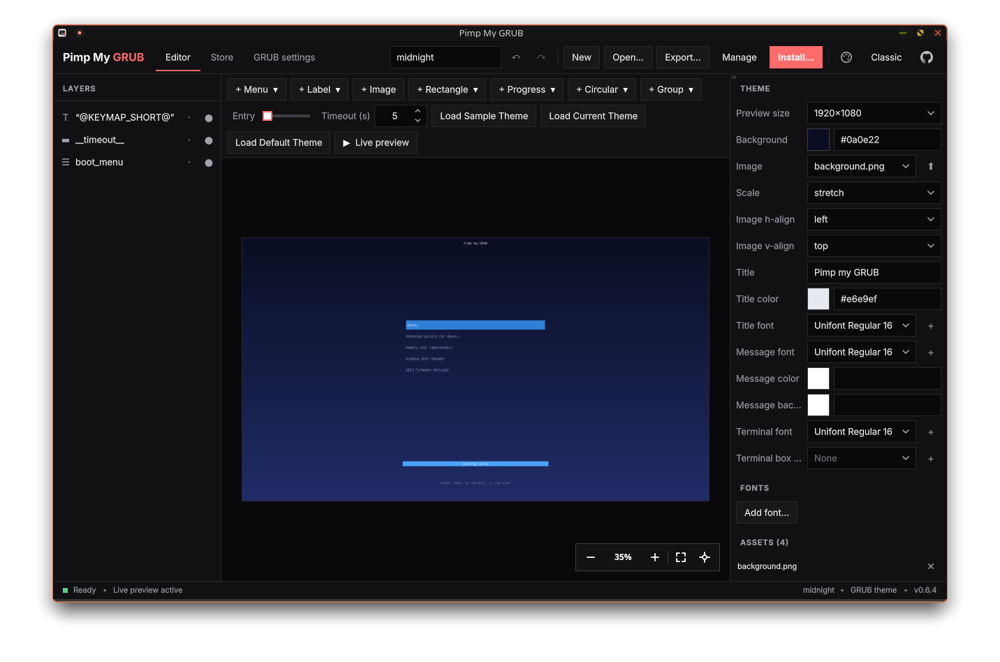
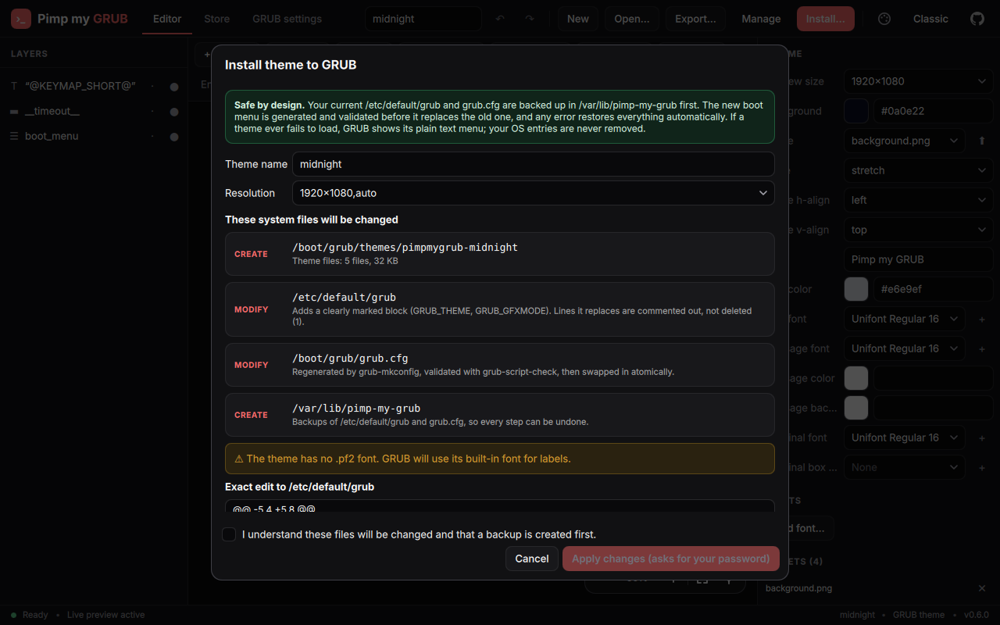
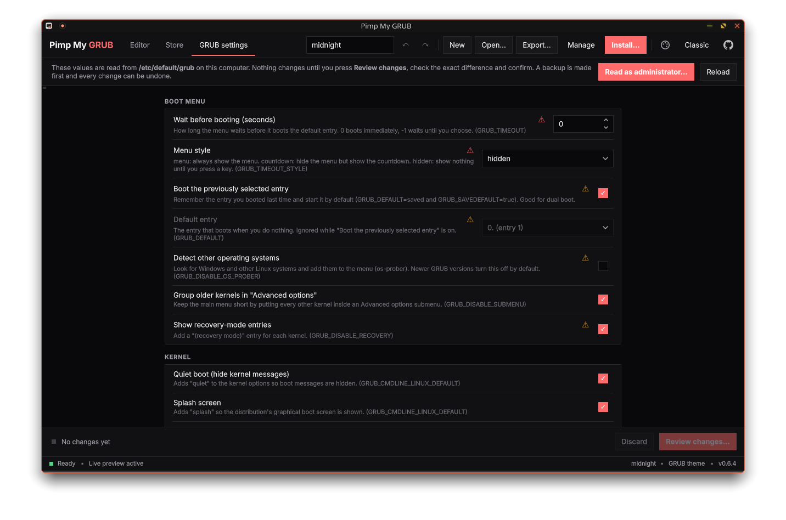
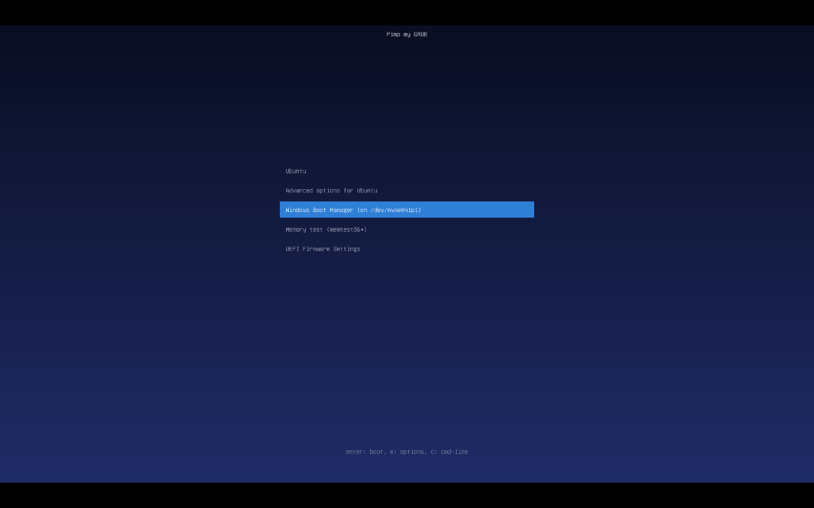
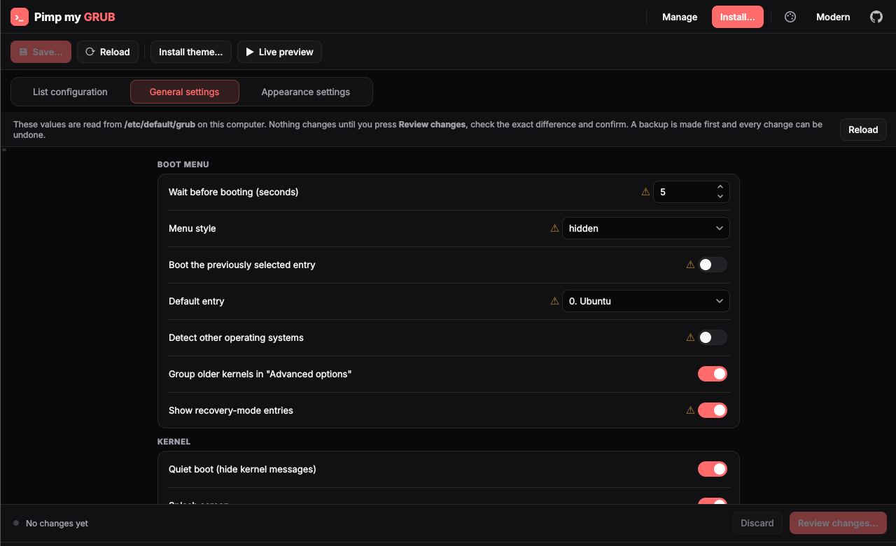
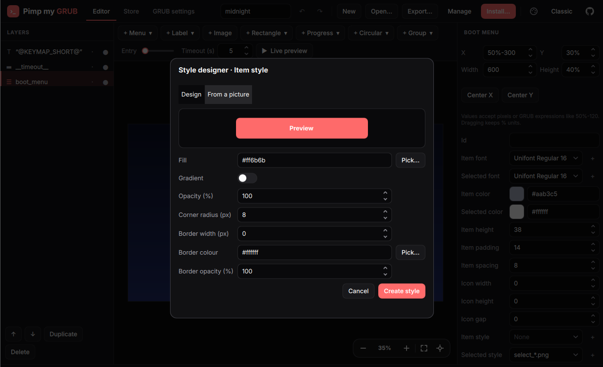
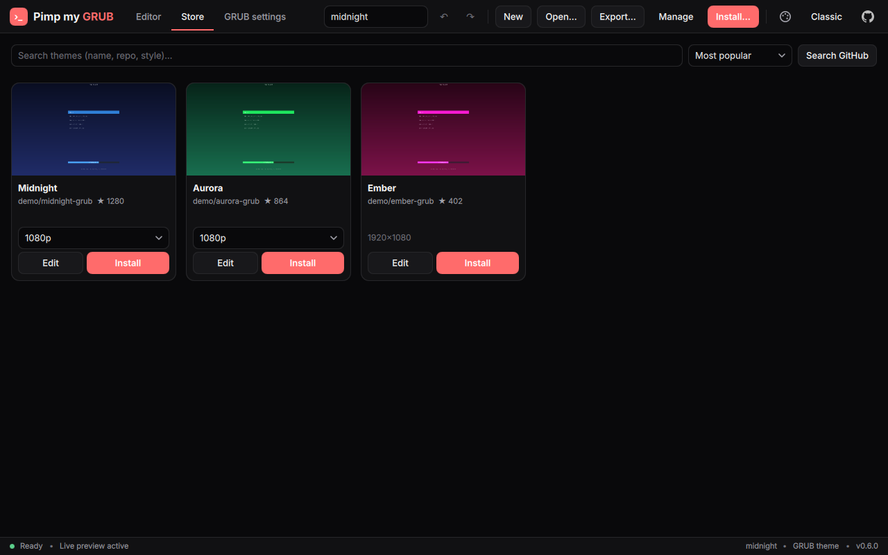
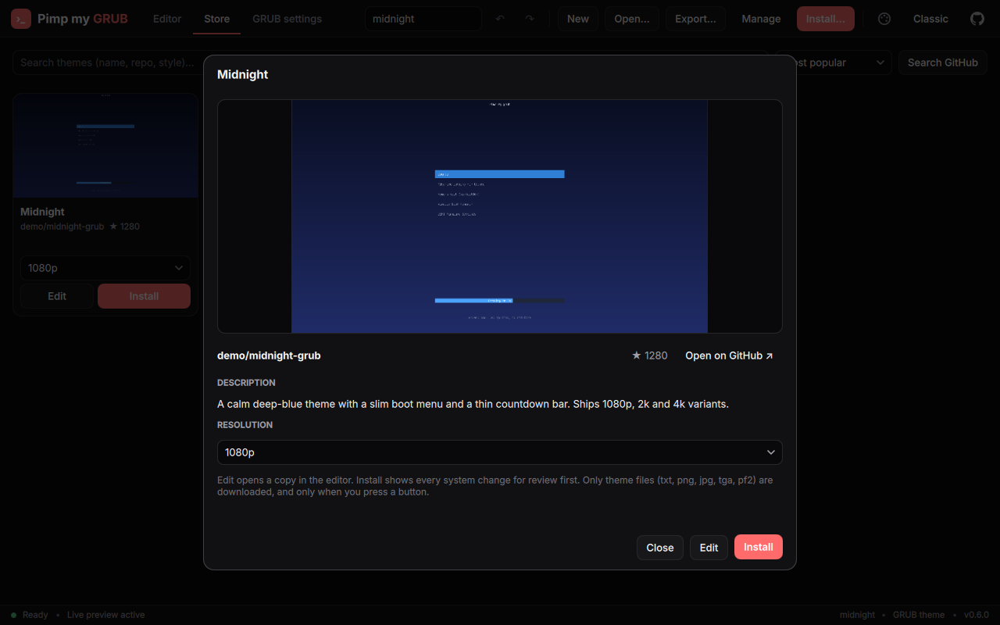
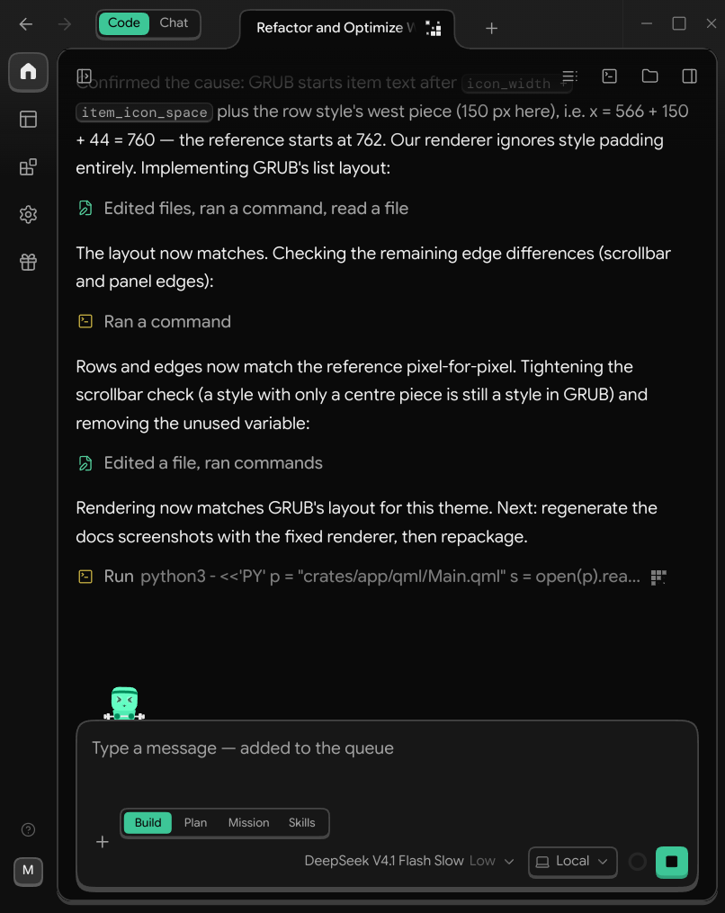
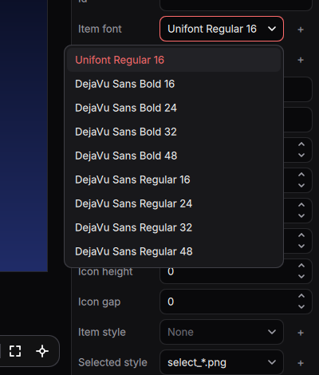

<p align="center"></p>

# Style My GRUB

**A native Linux app to design GRUB themes visually, browse a theme store, and install a theme safely.**
Qt 6 + Rust. No webview, no Electron. Every change to your system is shown to you first and can be undone.





| General | Live preview (full screen) |
|---|---|
|  |  |

| Classic layout | Style designer |
|---|---|
|  |  |

| Theme store | Theme details |
|---|---|
|  |  |

<p align="center"> </p>

*The store screenshots use a small offline demo catalog (made-up themes) so they can be reproduced without a network connection.*

> **Status: early (v0.7.0).** The editor, store UI and installer are working and tested in a sandbox, but the real
> apply-to-`/boot` path has **not** been exercised on real hardware yet. Try it in a VM first. See [Status](#status-what-is-and-isnt-verified).

## Why this exists
GRUB themes are a pile of `theme.txt`, PNG slices and `.pf2` fonts that you edit blind and only see after a reboot.
The goal of this project, as set out at the start:

-  **Build a theme**: drag, resize, snap, layers, inspector, live preview
-  **Theme store**: a search bar, preview cards and a detail view with description, fed by popular theme repositories
-  **Made in Rust** that stays fast on **low-end devices**
- install themes through a **guided, GRUB-respecting, reversible** flow that can never destroy booting, and tells you
  exactly what it changed in system files, with a **confirmation** step

## Inspiration and references

| Project | What it inspired |
|---|---|
| [sooocil/grubstudio](https://github.com/sooocil/grubstudio) | a visual theme builder and a `theme.txt` parser/exporter |
| [GRUB-Theme-Builder](https://erikenga2.github.io/GRUB-Theme-Builder/) | a browser-based GRUB theme builder, the starting "web version" idea |
| [Aleph1-9012/Sidonia](https://github.com/Aleph1-9012/Sidonia) | the install procedure: back up first, regenerate `grub.cfg` safely, roll back. Its themes are also the test corpus for the parser and renderer |

The store's curated list is seeded from popular repositories found through GitHub's `grub-theme` topic
(for example Gorgeous-GRUB, minegrub-theme, distro-grub-themes, fallout-grub-theme, catppuccin/grub, dedsec and darkmatter,
HyperFluent, CyberGRUB-2077, Sidonia). Themes stay in their own repositories under their own licences; the app only downloads them on demand.

## How the design got here (decisions)
1. **Prototype:** Tauri 2 + Svelte + Canvas2D (web UI) was built first. Svelte and Canvas2D were chosen for low overhead; the store
   combined a curated repo list with GitHub topic search; install went through `pkexec`.
2. **Rewrite to native:** the requirement changed to *not a web app*, *native for each popular distro*. The result is
   **Qt 6 for the window and Rust for everything else**, with one thin `QQuickPaintedItem` that blits a Rust software renderer.
   The web prototype was chucked in my bin of of man-made horrors beyond saving.
3. **Safety first, taken from Sidonia's approach:** keep GRUB's architecture intact (`/etc/default/grub` + `grub-mkconfig`),
   never hand-edit `grub.cfg`, make every change reversible, and always show what will change before asking for a password.

## Features
- **Editor:** layers, drag/resize with snap guides, undo/redo, zoom/pan, inspector, preview sizes (1920×1080 … 800×600).
  Percent-based positions such as `50%-120` survive dragging. Components: boot menu, label, image, rectangle, progress bar,
  circular progress, groups. Every numeric field has up/down arrows (click, hold to repeat, Shift for bigger steps), and the
  countdown preview (**Timeout**, in seconds, default 5) feeds countdown labels, progress bars and spinners.
  Zooming re-draws the theme at the zoomed size and enlarges it without any smoothing filter, so pictures and text stay
  crisp — a pixel of the real 1:1 theme simply becomes a bigger square, as if you were magnifying the actual GRUB screen.
- **Three starting points:** *Load Sample Theme* opens **Midnight**, the finished demo theme that ships with the app;
  *Load Current Theme* opens whatever GRUB uses on this computer right now (`GRUB_THEME`); *Load Default Theme* goes back to
  GRUB's own plain look (black screen, built-in font, inverted selected row). All three are one undo step.
- **File menu:** *New*, *Open* (folder or zip) and *Export* are grouped under one **File…** button in the toolbar.
- **New and Open ask first:** both replace the open theme and the editor cannot undo that, so a confirmation names the theme
  that will be lost (and suggests exporting it first). Its button says *Start new theme* or *Choose a theme…*, not *OK*.
- **Resizable panels:** on the Appearance tab, drag the thin handle between the layers list, the canvas and the inspector;
  the same handle separates the settings list from the file view on General, and the preview from the inspector in the
  classic *Appearance settings* tab. The middle panel takes the remaining width, so the editor still works on a smaller screen.
- **Right-click menu** (canvas and layers list), like a presentation program: cut / copy / paste / duplicate / delete, arrange (bring
  to front, send to back ...), align to the container, group / ungroup, lock, hide, create a style, add. Ctrl+C / X / V / G work too.
- **Presets** for every kind of item, behind the ▾ on each add button: 6 menus (centered list, sidebar, boxed, minimal, gradient,
  full-width), 5 labels (title, subtitle, key hints, countdown text, big timer), 5 rectangles (panel, card, divider, accent bar, fade),
  4 progress bars, 3 circular spinners, 4 groups (header and footer, stack, two columns ...).
- **Style designer:** GRUB draws selection bars, menu panels, progress tracks and scrollbars from nine-piece "styles". Make them from
  parameters (fill, gradient, opacity, rounded corners, border) or cut one from your own picture. This is what Sidonia-style
  themes are built from, and it was the missing piece for creating complex themes from scratch.
- **More of `theme.txt`:** scrollbar track/thumb/padding, `highlight_overlay`, `id` (for `__timeout__` countdown items), `message-*`,
  `terminal-*`, image alignment, icons from `icons/`. Menus scroll when there are more entries than fit.
- **List Config** (own tab): the boot entries GRUB lists on this computer, read from `grub.cfg` (or with one polkit
  password when only the administrator may read it). It sits between General and Themes in the modern layout,
  and is the first tab of the classic one. **Read-only on purpose**, behind a standing warning: hand-editing `grub.cfg` is
  unsafe, since GRUB regenerates that file and a mistake in it can stop the computer from booting. The default entry is
  changed on the General tab, with a review and a backup.
- **General** (own tab): the options of `/etc/default/grub` read from this computer and shown as checkboxes, numbers and choices:
  wait time, menu style, **boot the previously selected entry**, default entry, detect other operating systems, advanced-options
  submenu, recovery entries, quiet / splash, kernel options, distributor name, video mode, failed-boot wait. Each has help text,
  and a ⚠ warning where a wrong value can stop GRUB or the system from working. Changes are reviewed (exact diff), backed up,
  validated and can be undone. Most systems let only root read `/etc/default/grub` and `grub.cfg`; *Read as administrator…* then asks
  polkit for one password and reads them through the helper (it only copies them to a temporary folder). The UI itself never runs as root.
  Next to the options, the file itself is shown as it will look after the change: every line the change writes is highlighted,
  the lines it overrides are marked, and clicking a line points at the setting that owns it (read-only — the options are edited
  on the left, so nothing can be written that the helper would refuse).
- **Live preview** (F5, full screen): the finished theme with this computer's boot entries and timeout, a running countdown, keyboard
  control (↑ ↓ Home End, Enter simulated, e, c, Space pauses, R restarts the countdown, F1, Esc) and the mouse (click a row).
  It is drawn at the size it is shown, up to the theme's own resolution, so what you see is what GRUB draws — fonts, nine-piece
  styles, entry icons, the countdown items and the scroll bar. Nothing is booted.
- **Classic layout** (button next to GitHub): *List Config*, *General settings* and *Appearance settings*, arranged like the
  original GRUB Customizer. The *List Config* tab is the same read-only panel as in the modern layout; general settings
  are the same `/etc/default/grub` panel as the General tab, where the default entry is changed with a review and a backup.
- **Tooltips** on every button, property and setting.
- **Fonts:** the app ships its own interface fonts (it looks right even on a system with no fonts installed), 24 ready-made GRUB fonts
  (Inter, JetBrains Mono, DejaVu Sans; regular/bold; 16-48 px) and can turn **any font installed on the computer** (or a .ttf/.otf
  file) into a GRUB font itself. No `grub-mkfont` / GRUB install is needed.
- **Accurate preview:** real GRUB `.pf2` fonts are drawn glyph by glyph (so text looks like it will at boot), 9-slice
  `select_*.png` styles, icons and progress bars. TTF/OTF → PF2 conversion uses GRUB's own `grub-mkfont`.
- **Themes** (the store): search, sort by popularity, cards with lazily loaded thumbnails and a resolution picker, *Edit Theme* or *Install Theme* in one click,
  plus live search of GitHub's `grub-theme` topic. Click a card to open its **detail view**: large preview, the repository's
  description, stars, a link to its GitHub page and the resolution choice.
  `cargo run -p style-my-grub-core --example build_catalog` (with `GITHUB_TOKEN`) pre-indexes the curated repos so the app needs no API calls on startup (script written, not yet run against live GitHub).
- **Installer:** review screen listing every file that will change, the exact diff of `/etc/default/grub`, recovery instructions
  and a consent checkbox. Then polkit asks for your password.
- **Manage:** *Undo last change* or *Remove all* at any time.
- **System file choosers:** Open, Export, Add font, Upload image and the colour pickers use your desktop's own chooser
  (`zenity` on GTK/GNOME/XFCE/Cinnamon..., `kdialog` on KDE); Qt's built-in dialog is only the fallback when neither is
  installed. Set `STYLEMYGRUB_NATIVE_DIALOGS=0` to always use Qt's dialog.
- **Your colour:** the palette button in the header opens *Appearance*: pick the app's accent colour from presets, a hex
  field or the system colour chooser. It is remembered between runs. The GitHub button next to it opens the project page.
- **Light:** the theme preview is drawn on the CPU only when something changes (no frame loop), a virtualised store grid with
  downscaled async thumbnails, one small native executable.
- **Look:** a built-in dark theme with an accent colour you choose (coral by default), drawn with Qt Quick Controls' `Basic` style so it looks the same on every desktop (set `QT_QUICK_CONTROLS_STYLE` to override).

## Safety model
| Step | Guarantee |
|---|---|
| Backup | `/etc/default/grub`, `grub.cfg` and the previous theme go to `/var/lib/style-my-grub/backups`; the very first copy is kept forever in `/var/lib/style-my-grub/original` |
| Settings (`/etc/default/grub`) | only whitelisted keys with validated values, written as one marked block at the end of the file (your own lines are never edited); backed up first, `grub.cfg` regenerated and checked, automatic restore on any error, undo one step at a time |
| `/etc/default/grub` (theme) | one marked block is added; conflicting `GRUB_THEME` / `GRUB_GFXMODE` / `GRUB_TERMINAL=console` lines are **commented out, never deleted** |
| `grub.cfg` | never edited by hand: regenerated with `grub-mkconfig` into a temp file, checked with `grub-script-check`, must reference the new theme and still contain menu entries, then renamed atomically |
| Failure | any error triggers an automatic restore (undo stack); covered by `tests/helper.test.sh` including failure injection |
| Undo | surgical, so your later edits to `/etc/default/grub` are kept |
| Input | only `txt png jpg jpeg tga pf2`, no symlinks, safe file names, ≤ 40 MB; the staged copy is re-validated as root |
| Boot | if a theme ever fails to load, GRUB shows its plain text menu; OS entries are never touched |

Manual recovery: copy `/var/lib/style-my-grub/original/default-grub` back to `/etc/default/grub`, then `sudo update-grub`
(Debian/Ubuntu) or `sudo grub2-mkconfig -o /boot/grub2/grub.cfg` (Fedora/openSUSE).

Privileges: packages install `/usr/libexec/style-my-grub/style-my-grub-helper` and a polkit action (`dev.stylemygrub.helper`), so the
prompt names the app. Without it (AppImage, dev builds) the app falls back to `pkexec /bin/sh -c <embedded script>`.
**Supported:** GRUB 2 on Debian/Ubuntu/Arch/Fedora/openSUSE families. 
**Not supported:** ostree/immutable systems, systemd-boot, rEFInd.

## Install
Get the files from [Releases](https://github.com/Mahaadevan/style-my-grub/releases).

| You have | Download | Notes |
|---|---|---|
| Debian, Ubuntu, Mint, Pop!_OS ... | `style-my-grub_<version>_amd64.deb` | `sudo apt install ./style-my-grub_*.deb`. Carries its own Qt 6, so the system's Qt version does not matter. |
| Any other distribution | `style-my-grub-<version>-x86_64.AppImage` | `chmod +x` and run. Carries its own Qt 6. Needs FUSE 2 (`libfuse2`) or run it with `--appimage-extract-and-run`. |
| Fedora, openSUSE | the `.rpm` | built against the distribution's Qt |
| Arch, Manjaro | `PKGBUILD` in `packaging/` (`makepkg -si`) | built against the distribution's Qt |

**Which systems do the .deb and AppImage run on?** They bring their own Qt and C++ runtime, so the Qt on your system is irrelevant
(older, newer or none at all). The one thing they need from the system is a **glibc at least as new as the machine that built them**
(the release workflow builds on Ubuntu 20.04, glibc 2.31: Debian 11+, Ubuntu 20.04+, Fedora 32+, openSUSE 15.2+ and all newer).
Also required from the system: a display (X11 or Wayland), OpenGL/EGL (`libgl1`, `libegl1`), fontconfig, polkit. Optional: `zenity` or
`kdialog` (system file chooser) and `grub-common` (to apply themes on a Debian-family system).

## Compatibility

| | Runs | Notes |
|---|---|---|
| **Boot loader** | GRUB 2.02 – 2.12 | Debian/Ubuntu/Mint/Pop!_OS, Fedora/RHEL, openSUSE, Arch/Manjaro, and anything else using GRUB 2 |
| **Not supported** | systemd-boot, rEFInd, ostree/immutable systems (Silverblue, NixOS-style read-only `/boot`) | the app says so instead of breaking the boot loader |
| **Display servers** | Wayland (EGL) and X11 (GLX/EGL) | GPU drawing by default on both; `STYLEMYGRUB_SOFTWARE=1` forces the CPU renderer, and the launcher retries once in safe mode if a driver crashes |
| **Desktops** | KDE Plasma, GNOME, XFCE, Cinnamon, MATE, Budgie… | the app has its own fonts and Qt style, so it looks the same everywhere; `zenity` or `kdialog` provides the system file chooser (Qt's own dialog is the fallback) |
| **Distribution for the .deb / AppImage** | any glibc ≥ 2.31 (Debian 11+, Ubuntu 20.04+, Fedora 32+, openSUSE 15.2+) | they bundle their own Qt 6 and C++ runtime, so the system's Qt does not matter; check yours with `ldd --version` |
| **Distribution for a source build / .rpm / PKGBUILD** | whatever the distribution's Qt 6 is (6.5 or newer recommended) | the .rpm and PKGBUILD are built against the distribution's Qt, not bundled |
| **Hardware** | x86_64 | aarch64/arm64 is untested (nothing in the code is x86-specific) |
| **Privileges** | polkit (`pkexec` + the installed polkit action) | the packages install it; a source/AppImage run falls back to `pkexec /bin/sh -c <embedded script>`; the UI itself never runs as root |
| **Disk layouts** | `/boot` on ext4, btrfs, xfs, or the same filesystem as `/` | encrypted `/boot` and some Btrfs+LVM setups are handled defensively (dry-run first, automatic rollback) but have not been tried on real hardware |

What it needs from the system at run time: a display (X11 or Wayland), OpenGL/EGL (`libgl1`, `libegl1`),
fontconfig and polkit. Optional: `zenity` or `kdialog` (system file chooser) and `grub-common` (to apply themes and to use
GRUB's full `unicode.pf2` for previews; a built-in font is used when it is missing). Previewing and editing a theme never
needs root; only *Read as administrator…* and installing ask for a password.

## Build from source
Rust 1.85+, Qt 6 (Quick, Quick Controls 2, Dialogs), clang. At run time `zenity` (or `kdialog` on KDE) provides the system file chooser; without it Qt's own dialog is used. `grub-common` is optional at build time: previews use a built-in
font, or GRUB's full `unicode.pf2` when it is installed; `grub-mkfont` (from `grub-common`) is only needed to convert your own fonts.
```bash
# Debian/Ubuntu 24.04+
sudo apt install qt6-base-dev qt6-declarative-dev clang libclang-dev \
  qml6-module-qtquick qml6-module-qtquick-controls qml6-module-qtquick-layouts \
  qml6-module-qtquick-dialogs qml6-module-qtquick-templates qml6-module-qtquick-window \
  qml6-module-qtqml-workerscript qml6-module-qt-labs-folderlistmodel
# Fedora: qt6-qtbase-devel qt6-qtdeclarative-devel clang-devel     Arch: qt6-base qt6-declarative clang

QMAKE=$(command -v qmake6) cargo build --release -p style-my-grub
./target/release/style-my-grub examples/midnight     # opens the demo theme
```
Tests: `cargo test -p style-my-grub-core && sh tests/helper.test.sh`.
`STYLEMYGRUB_CATALOG=catalog.json` replaces the bundled store catalog (offline mirrors, testing).
Note: the first build compiles the Qt bindings (`cxx-qt-lib`) and takes about ten minutes (longer on one core).

Packages (see `packaging/`):
open the packaging directory in terminal and run `build-binary.sh`

| Distro family | Package | Build |
|---|---|---|
| Debian, Ubuntu, Mint | `.deb` (self-contained, bundles Qt) | `sh packaging/build-deb.sh` |
| Fedora, openSUSE | `.rpm` | `packaging/style-my-grub.spec` |
| Arch, Manjaro | `PKGBUILD` | `makepkg -si` in `packaging/` |
| Anything else | AppImage (self-contained, bundles Qt) | `packaging/build-appimage.sh` |

To make a package that runs on **older** systems, build it on an old one: `.github/workflows/release.yml` does this in an Ubuntu 20.04 container
with the official Qt binaries (`aqtinstall`). A build made on Ubuntu 24.04 needs glibc 2.39, so it will not start on older distributions.

Flatpak is intentionally not offered: a sandbox cannot run polkit against `/boot`.

### If the app crashes or does nothing when started
The program draws through Qt's normal graphics stack: **EGL/OpenGL on Wayland, GLX/EGL on X11** (Vulkan where Qt prefers it), so the
window is tear-free and correctly scaled on HiDPI screens. If the driver cannot create a graphics context, `STYLEMYGRUB_SOFTWARE=1`
forces CPU drawing (equivalently `QT_QUICK_BACKEND=software`). The launcher also retries once in **safe mode** (software drawing, X11
instead of Wayland) when the app crashes in its first seconds, and remembers it. You can force it with `STYLEMYGRUB_SAFE=1`, or go back to normal with `STYLEMYGRUB_SAFE=0` (and delete
`~/.cache/style-my-grub/safe-mode`). Diagnostics are in `~/.cache/style-my-grub/`: `last-run.log`, `first-attempt.log` (the crash that
triggered safe mode) and `crash.log` (internal errors with a backtrace). To see everything live, start it from a terminal.

### If the app does nothing when started
If you installed the **.deb or AppImage** and see `undefined symbol` or a Qt error, you are probably running an older build
(before 0.5.0) in which the bundled Qt was not used; update. If you see `GLIBC_x.y not found`, your system is older than the machine that
built the package: use a package built on an older base, or build from source.
For a **source / distribution** build, run `style-my-grub` from a terminal. If it prints `module "QtQuick.Dialogs" is not installed` (or another module), install the
`qml6-module-*` packages listed above (Debian/Ubuntu) or the full `qt6-declarative` package (Fedora/Arch/openSUSE).
Started from the app menu, a failure now shows an error dialog and writes `~/.cache/style-my-grub/last-run.log`.
Release binaries built against Qt private API only run on the same Qt 6 minor version; use the AppImage elsewhere.

## Repository layout
```
crates/core/   engine, no GUI deps: theme.txt model, PF2 reader, tiny-skia renderer, editor + undo, store, installer client
crates/app/    Qt Quick shell (cxx-qt): QML UI and the painted viewport item
helper/        style-my-grub-helper.sh, the only code that touches system files
packaging/     deb / rpm / PKGBUILD / AppImage, desktop file, polkit policy, metainfo
examples/      "midnight", a small demo theme
tests/         helper safety tests against a fake GRUB tree
```

## Status: what is and isn't verified
**Checked**
- core unit tests (parser round-trip on the real Sidonia themes, store indexer, undo/redo, drag, export) and helper safety
  tests (apply, rollback, failed apply restores state, theme-override refusal, hostile input, uninstall)
- the new editing features: every preset renders and survives a `theme.txt` round trip, styles made by the designer or cut from a
  picture are valid nine-piece sets that the menu uses, clipboard / stacking / group / align and undo, countdown labels, host
  entries with scrolling, fonts converted to PF2 and read back, and the GRUB settings model (parsing, `1>2` entry numbering,
  minimal changes, hostile input refused)
- the settings helper (`cplan` / `capply`): marked block, original lines untouched, merge across changes, one-step rollback to the
  exact previous file, hostile input and symlinks refused, failure injection restores state, coexistence with a theme, uninstall
- the app launched under a virtual display (with and without a window manager): editor with a real theme, layers/inspector, store grid and detail view (with an
  offline test catalog), the install review dialog, the system folder chooser (zenity), the Appearance dialog and its saved colour, the settings page with a **real apply and undo button** (as root in a sandbox, with a stand-in for pkexec), the full-screen live preview with host entries and keyboard control, the classic layout, the right-click menu, preset menus, the font picker (365 fonts) and the style designer, and the startup-failure path (missing QML
  module gives a message and a non-zero exit); a `.deb` installs and removes cleanly

**Not checked yet**
- the settings page on a real system through polkit (only a sandbox with a stand-in for `pkexec` was used), and on distributions whose
  `/etc/default/grub.d` snippets override the same keys (detected and warned about, but not tried)
- the live preview and the classic layout on Wayland and on high-DPI screens; real full-screen behaviour on desktops other than a bare window manager
- complex Sidonia-like themes rebuilt from scratch in the editor (the building blocks are tested one by one, not a full recreation)
- applying a theme to a real `/boot` through polkit, and the polkit prompt itself
- store behaviour with live GitHub data (thumbnails, downloads, rate limits)
- the KDE `kdialog` chooser (only `zenity` was exercised), the XDG portal, and Wayland
- the `.rpm` and `PKGBUILD` builds, and the release workflow itself (`.github/workflows/release.yml` was written but never run)
- the AppImage and .deb on a machine older than Ubuntu 24.04, and on aarch64
- BIOS/UEFI/encrypted-`/boot` edge cases, and distros' `/etc/default/grub.d` overrides (detected and refused, but untested on real systems)

**Known limits**
- the preview covers common components; exotic theme features are ignored
- the store's description is the repository's description, so every theme from one repository shares it
- GitHub's unauthenticated API is rate-limited; pre-build `data/catalog.json` with the example above before releases

## Roadmap
real-hardware and VM test matrix · `.rpm`/Arch/AppImage CI · store thumbnails cache cleanup · component tree drag-and-drop ·
more GRUB components (terminal box, icons editor) · translations

## Contributing
Issues and PRs welcome. Please run the tests first, and for anything touching `helper/` keep the safety model above intact
(add a failure-injection test). See [CONTRIBUTING.md](CONTRIBUTING.md).

## License
GPL-3.0-or-later, see [LICENSE](LICENSE). Third-party themes belong to their authors and keep their own licences.
